<p align="center">
  <picture>
    <source media="(prefers-color-scheme: dark)" srcset="public/icon-dark.svg">
    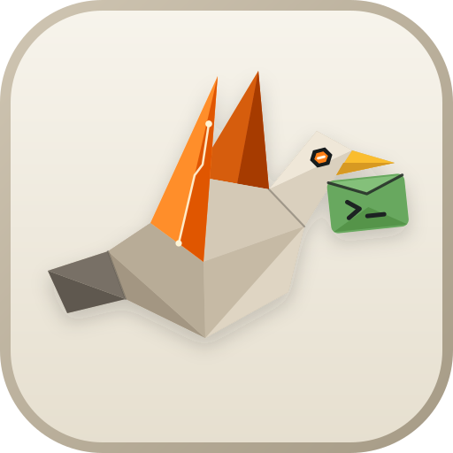_ terminal envelope">
  </picture>
</p>

# Pigeon

Pigeon puts the coding agents running in [Herdr](https://herdr.dev) on your phone. Instead of pinching and zooming a terminal, you get a mobile web app for **Claude Code**, **Codex**, **OpenCode**, **Antigravity**, and **pi**. Check which agent is working or waiting on you, read its changes, answer prompts with a tap, queue your next message, or start and resume sessions from the couch.

A small daemon runs alongside Herdr on your computer and serves the app over your Tailscale network. Everything compiles into a single binary.

<p align="center">
  <picture>
    <source media="(prefers-color-scheme: dark)" srcset="docs/images/home-dark.png">
    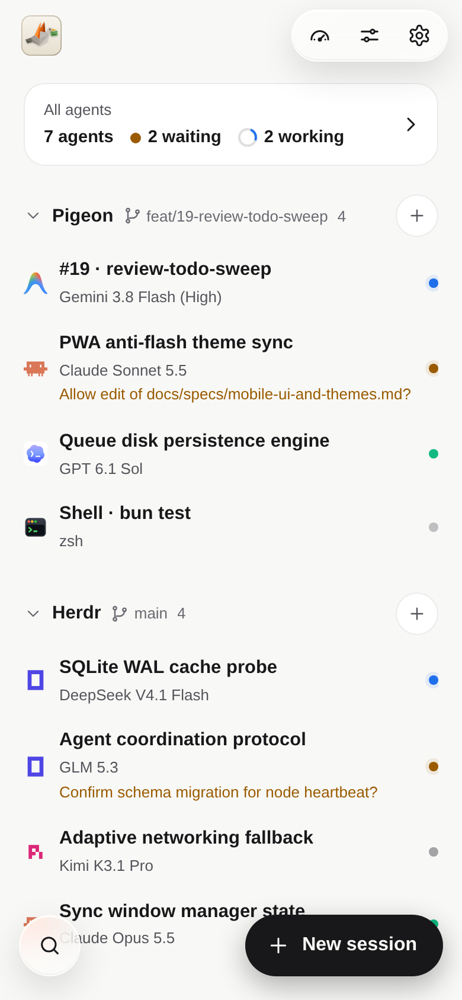
  </picture>
  &nbsp;
  <picture>
    <source media="(prefers-color-scheme: dark)" srcset="docs/images/agents-dark.png">
    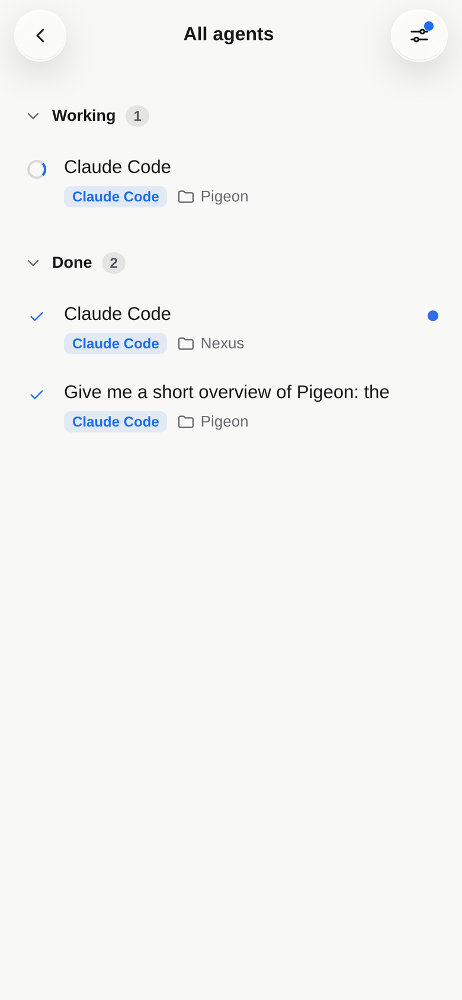
  </picture>
  &nbsp;
  <picture>
    <source media="(prefers-color-scheme: dark)" srcset="docs/images/session-dark.png">
    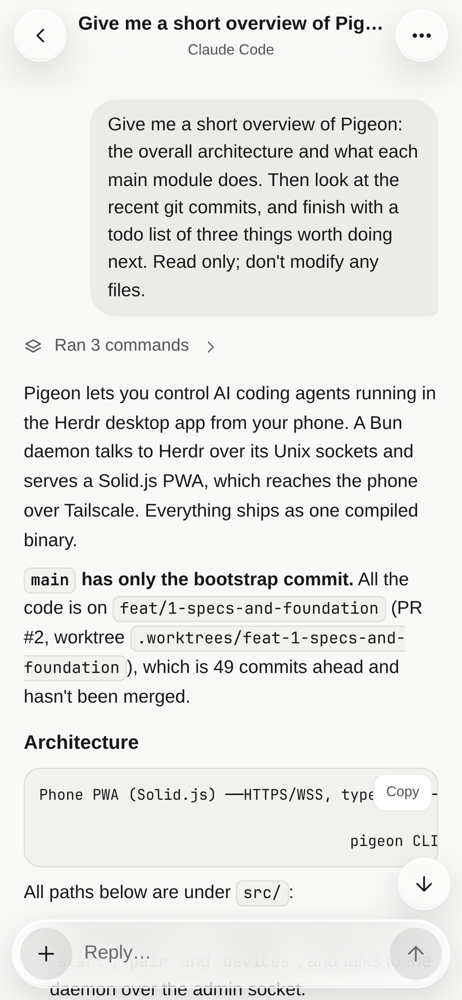
  </picture>
</p>
<p align="center">
  <picture>
    <source media="(prefers-color-scheme: dark)" srcset="docs/images/prompt-dark.png">
    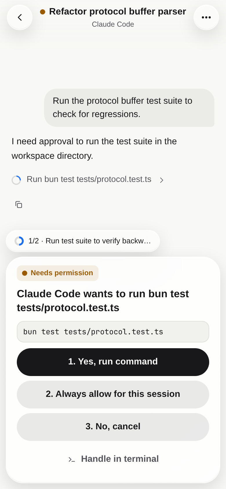
  </picture>
  &nbsp;
  <picture>
    <source media="(prefers-color-scheme: dark)" srcset="docs/images/diff-dark.png">
    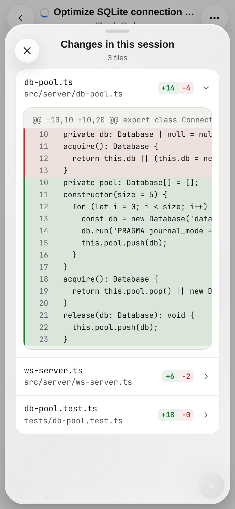
  </picture>
  &nbsp;
  <picture>
    <source media="(prefers-color-scheme: dark)" srcset="docs/images/queue-dark.png">
    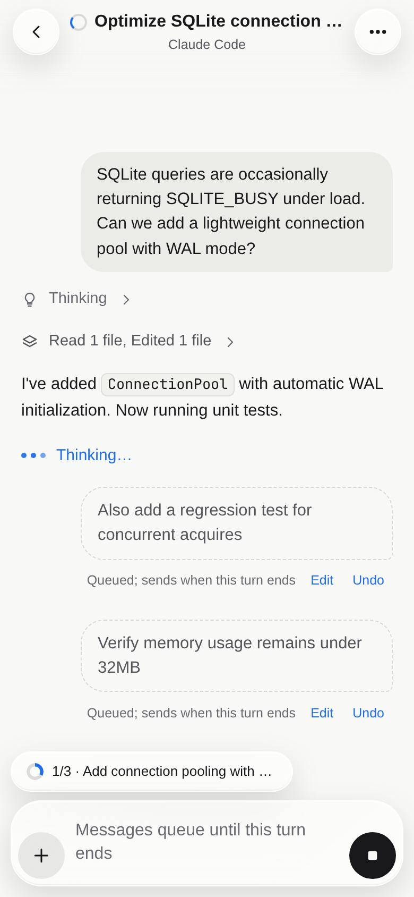
  </picture>
</p>
<p align="center">
  <picture>
    <source media="(prefers-color-scheme: dark)" srcset="docs/images/commands-dark.png">
    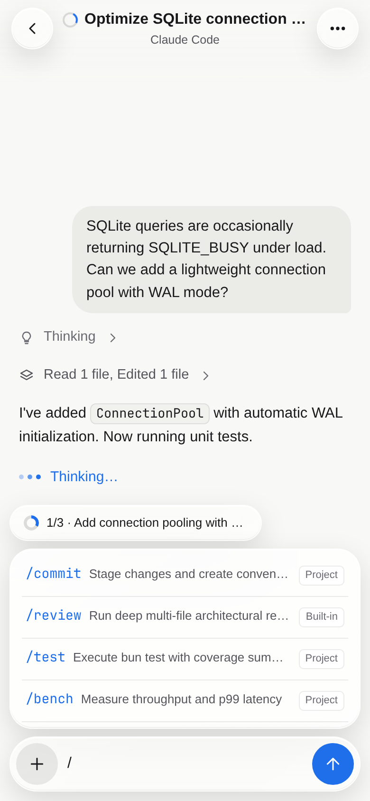
  </picture>
  &nbsp;
  <picture>
    <source media="(prefers-color-scheme: dark)" srcset="docs/images/quota-dark.png">
    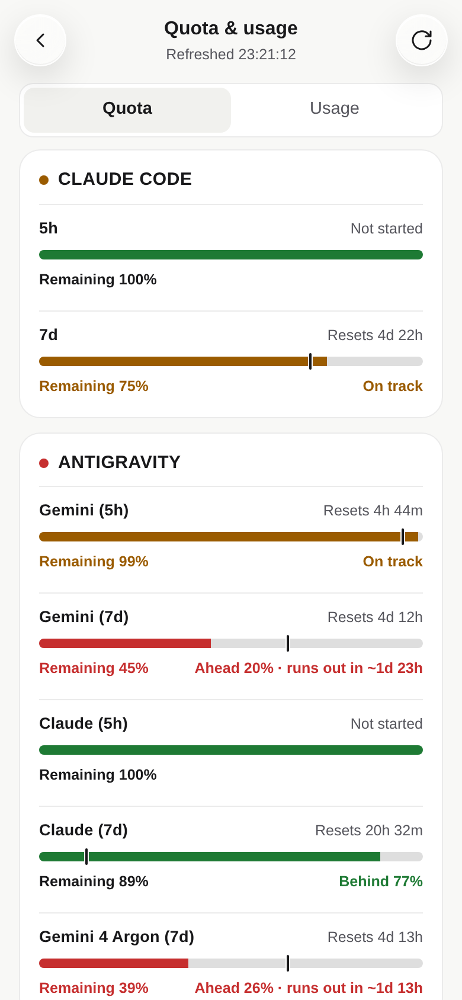
  </picture>
  &nbsp;
  <picture>
    <source media="(prefers-color-scheme: dark)" srcset="docs/images/usage-dark.png">
    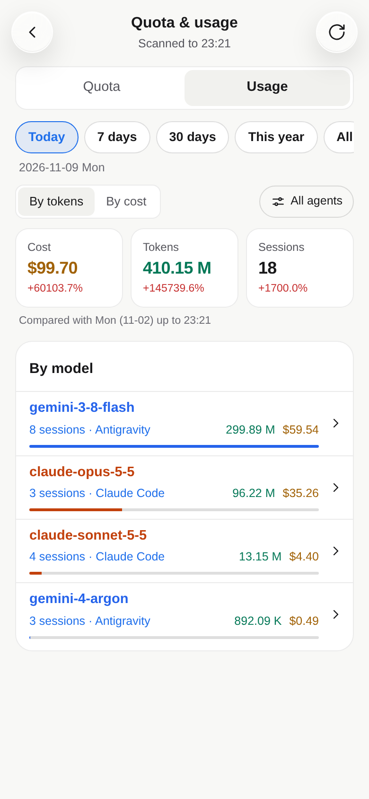
  </picture>
</p>

## Installation

Install Pigeon globally with **bun**:

```bash
bun add -g @fangwangme/pigeon
```

Or run it directly without installing:

```bash
bunx @fangwangme/pigeon
```

*(Also installable with **npm**: `npm install -g @fangwangme/pigeon` or `npx @fangwangme/pigeon`)*

Start the daemon:

```bash
pigeon start
```

`pigeon start` automatically verifies or configures [Tailscale serve](https://tailscale.com) for secure HTTPS/WSS access (on port `4100`) and displays a pairing QR code in the terminal.

Scan the QR code with Chrome on Android (or Safari / Chrome on iOS), then choose **Add to Home screen** to install the PWA.

Prebuilt binaries are published for macOS (Apple Silicon and Intel) and Linux (x64 and arm64); bun or npm picks the one for your machine. On other platforms, [build from source](#build-from-source). See [Requirements](#requirements) and the [Tailscale Setup Guide](docs/usage/tailscale.md).

## What it does

- **Every workspace at a glance.** Browse your Herdr workspaces and tabs with live status dots (`waiting for you`, `working`, green `done` when finished, gray `idle` once viewed, or plain terminal). Open **All agents** to see every active agent across workspaces, toggle between **group by status** (`Needs you`, `Working`, `Done`, `Idle`) and **group by workspace** (with urgency status priority preserved within every group), or search and filter by status, agent, or name.
- **Conversations, not terminal scrollback.** Prompts, Markdown replies, collapsible reasoning, grouped tool calls, file diffs, and task lists read like a chat thread, backed by each agent's own session log. If a pane doesn't have a session log yet, Pigeon parses the terminal screen into clean cards instead.
- **Answer prompts with a tap.** When an agent pauses for permission, asks a question, or waits on a plan, a prompt card takes the place of the reply box. Numbered choices become tap buttons; arrow-key menus and `y/n` prompts open the terminal sheet so Pigeon never guesses keystrokes.
- **Keep the work moving.** Reply at any time—if the agent is still working, your message queues until the turn finishes (with one-tap undo). Attach photos or files from your phone, insert `/` commands and skills from your project or user config, or stop a turn mid-flight.
- **A real terminal when you need one.** Peek at any pane's live screen and send arrow keys, `Enter`, `Esc`, `Tab`, or `Ctrl+C`. Plain shell tabs open straight to the terminal view and let you run commands from the reply box.
- **Session models, brand icons, and account tracking.** Clean, borderless brand vector icons (Antigravity arch, Claude crab, Codex rosette, OpenCode, Pi, Shell) sit inline with session cards. Model tags display friendly Reader names (prioritizing workspace display when screen space is tight). Automatic account detection displays your logged-in Google / Antigravity email.
- **Live rate limits and token usage.** Track 5h rolling windows, daily rate limits, and reset countdowns across Antigravity, Claude Code, and Codex in **Quota**. Inspect token volume, estimated costs, and daily activity trends in **Token Usage** (with a single master toggle in Settings to enable or disable telemetry).
- **Start, resume, and manage tabs.** Launch an agent or shell in a new Herdr tab, or pick up a past Claude Code, Codex, OpenCode, or pi session where you left off. Configure models and thinking/reasoning effort at launch (and switch models mid-session in Claude Code). Rename or close tabs and switch between panes without disturbing focus on your computer.
- **Native-feel PWA, light, dark, English, or Chinese.** Standalone PWA installable on iOS and Android with anti-flash critical styles. Follow your system theme or choose light or dark with a shared accent color, plus a per-phone **Reduce transparency** toggle if you prefer solid panels over glass. Available in English and Simplified Chinese.

### Visual identity

<p align="center">
  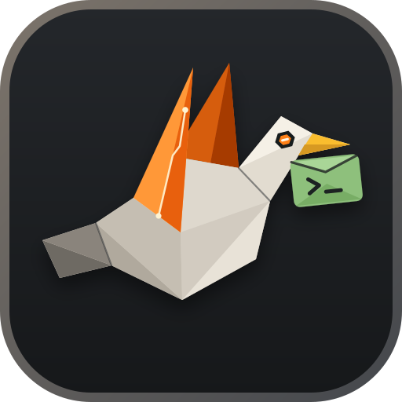
  &nbsp;&nbsp;&nbsp;&nbsp;
  
</p>

Pigeon's emblem is a faceted bionic messenger pigeon in flight—sculpted from warm titanium-ceramic armor plates, a glowing hexagonal AI optical visor, and solar-orange wings traced with a neural pulse circuit—carrying a green `>_` terminal envelope beneath its beak. It captures what Pigeon does at a glance: an autonomous courier ferrying prompts, approvals, and replies between your phone and the terminal coding agents on your desk, with dedicated **Dark** (`public/icon-dark.svg`) and **Light** (`public/icon-light.svg`) palettes that adapt across the README, browser favicon (`public/icon.svg`), pairing screen, and new-session view.

## How it works

```
Phone (Chrome / Safari PWA) ──HTTPS / WSS over Tailscale──▶ pigeon daemon ──Unix sockets──▶ Herdr App + Herdr Core
                                                                ├── reads agent session logs on disk (JSONL / SQLite)
                                                                ├── connects to Antigravity Language Server RPC
                                                                └── local admin socket ◀── pigeon CLI
```

- **Automatic Tailscale serve.** On launch, `pigeon start` checks and activates `tailscale serve` on port `4100` so your phone connects over a secure, encrypted HTTPS/WSS tunnel within your private tailnet.
- **Two local sockets to Herdr.** The daemon talks to the **Herdr App** (`herdr-app.sock`) to list, create, rename, and close tabs, and to **Herdr Core** (`herdr-core`) to subscribe to terminal status events, read screens, and send input.
- **Live session logs & Language Server.** Tails agent session logs on disk (JSONL or SQLite) as turns arrive, and connects directly to local agent services (such as the Antigravity Language Server RPC over loopback) for live quota windows.
- **QR pairing.** Scan the QR code printed in your terminal to pair a phone. The one-time code travels in the URL fragment (`#code=...`, so it never appears in HTTP headers or server logs) and is exchanged for an `HttpOnly` session cookie. You can view or revoke paired phones anytime from Settings or `pigeon devices`.

The full design and contracts live in [`docs/specs/`](docs/specs/).

## Requirements

- The [Herdr](https://herdr.dev) desktop app (`herdr-app` + `herdr-core`) running on your computer with its window open. (The older terminal-only `herdr` TUI is not supported.)
- [Bun](https://bun.sh) (recommended) or [Node.js](https://nodejs.org) to install, or Bun to build from source.
- [Tailscale](https://tailscale.com) on both your computer and your phone, signed into the same tailnet, so the phone gets a trusted HTTPS address for PWA installation and service workers. See the [Tailscale Setup Guide](docs/usage/tailscale.md) for step-by-step HTTPS configuration, firewall rules, and mobile pairing.
- Chrome on Android, or Safari / Chrome on iOS.

## Pairing and devices

While the daemon is running, you can manage pairing and devices from another terminal (or from **Settings** in the app):

- Rotate the pairing link and print a new QR code:
  ```bash
  pigeon pair
  ```
- Print a single-use link that expires in 10 minutes:
  ```bash
  pigeon pair --ephemeral
  ```
- List paired browsers:
  ```bash
  pigeon devices
  ```
- Revoke a paired browser immediately:
  ```bash
  pigeon devices revoke <id>
  ```
- Show active session count and public URL:
  ```bash
  pigeon status
  ```
- Rebuild the token usage and cost cache from scratch:
  ```bash
  pigeon rebuild-cache
  ```

## Build from source

```bash
bun install
bun run build
./dist/pigeon start
```

Or install `pigeon` onto your `PATH`:

```bash
install -m 755 dist/pigeon ~/.local/bin/pigeon
```

To keep `pigeon` running with `systemd` and push updates to your phone as you work, see [`docs/usage/README.md`](docs/usage/README.md). For HTTPS certificates and remote access setup, see the [`Tailscale Setup Guide`](docs/usage/tailscale.md).

## Status

Pigeon is actively maintained and tested across agents. Multi-agent session normalization, live streaming, interactive approvals, file diffs, prompt queueing, quota tracking, and usage telemetry are fully implemented and verified by 316 automated tests. Run `bun test` to build the client, type-check the repository, and execute the test suite. Push notification delivery over Web Push is in preparation (push toggles in Settings remain disabled for now).
