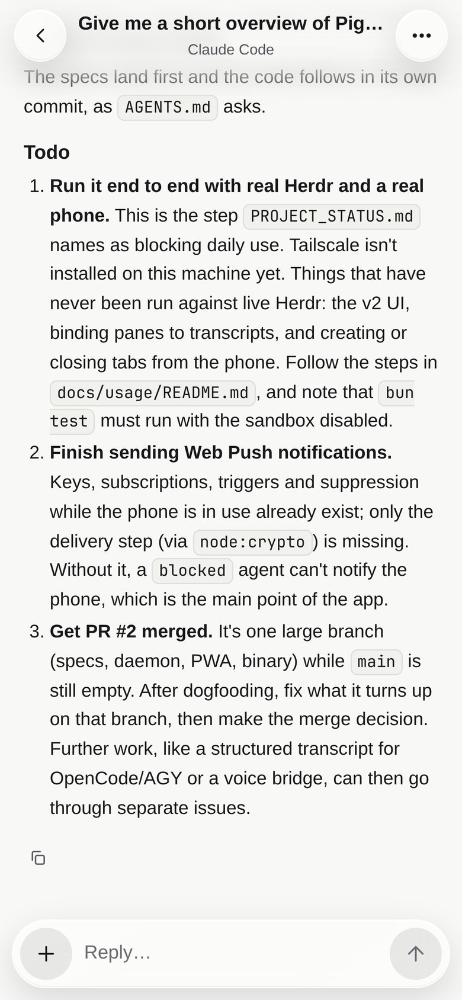
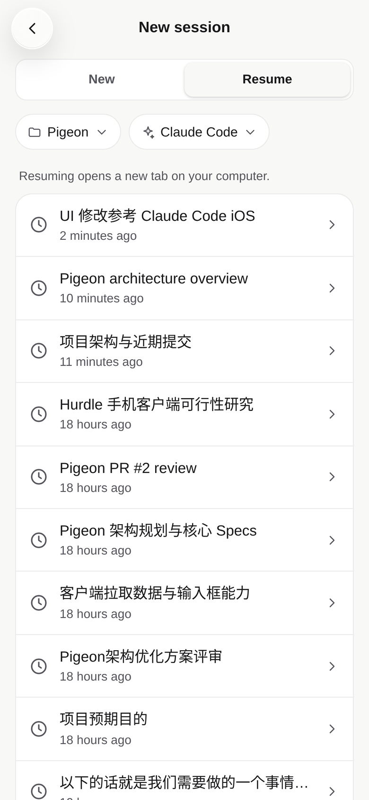
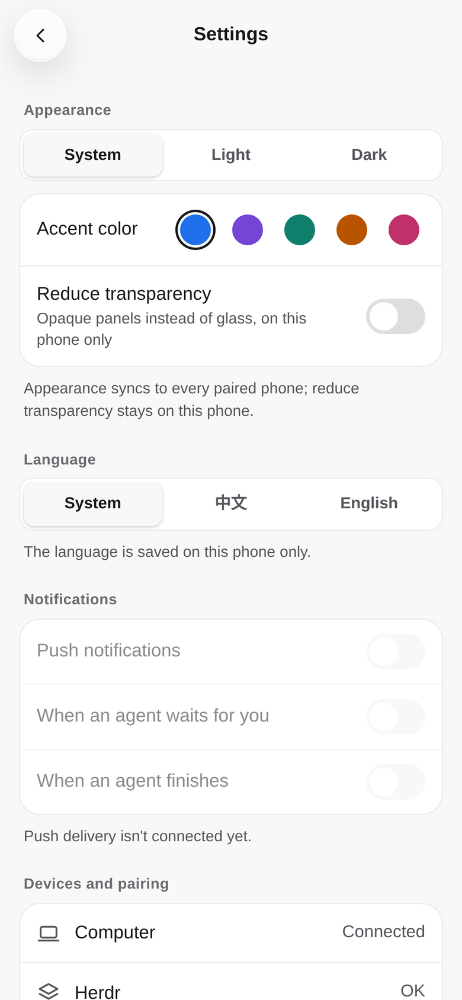

<p align="center">
  <picture>
    <source media="(prefers-color-scheme: dark)" srcset="public/icon-dark.svg">
    
  </picture>
</p>

# Pigeon

Pigeon puts the coding agents running in [Herdr](https://herdr.dev) on your phone. Instead of pinching and zooming a terminal, you get a mobile web app for **Claude Code**, **Codex**, **OpenCode**, **Antigravity**, and **pi**. Check which agent is working or waiting on you, read its changes, answer prompts with a tap, queue your next message, or start and resume sessions from the couch.

A small daemon runs alongside Herdr on your computer and serves the app over your Tailscale network. Everything compiles into a single binary.

<p align="center">
  <picture>
    <source media="(prefers-color-scheme: dark)" srcset="docs/images/home-dark.png">
    
  </picture>
  &nbsp;
  <picture>
    <source media="(prefers-color-scheme: dark)" srcset="docs/images/session-dark.png">
    
  </picture>
  &nbsp;
  <picture>
    <source media="(prefers-color-scheme: dark)" srcset="docs/images/answer-dark.png">
    
  </picture>
  &nbsp;
  <picture>
    <source media="(prefers-color-scheme: dark)" srcset="docs/images/agents-dark.png">
    
  </picture>
</p>
<p align="center">
  <picture>
    <source media="(prefers-color-scheme: dark)" srcset="docs/images/commands-dark.png">
    
  </picture>
  &nbsp;
  <picture>
    <source media="(prefers-color-scheme: dark)" srcset="docs/images/resume-dark.png">
    
  </picture>
  &nbsp;
  <picture>
    <source media="(prefers-color-scheme: dark)" srcset="docs/images/settings-dark.png">
    
  </picture>
</p>

## What it does

- **Every workspace at a glance.** Browse your Herdr workspaces and tabs with live status (`waiting for you`, `working`, `done`, `idle`, or plain terminal) and unread dots for sessions that finished while you were away. Open **All agents** to see every active agent across workspaces grouped by state, or search and filter by status, agent, or name.
- **Conversations, not terminal scrollback.** Prompts, Markdown replies, collapsible reasoning, grouped tool calls, file diffs, and task lists read like a chat thread, backed by each agent's own session log. If a pane doesn't have a session log yet, Pigeon parses the terminal screen into clean cards instead.
- **Answer prompts with a tap.** When an agent pauses for permission, asks a question, or waits on a plan, a prompt card takes the place of the reply box. Numbered choices become tap buttons; arrow-key menus and `y/n` prompts open the terminal sheet so Pigeon never guesses keystrokes.
- **Keep the work moving.** Reply at any time—if the agent is still working, your message queues until the turn finishes (with one-tap undo). Attach photos or files from your phone, insert `/` commands and skills from your project or user config, or stop a turn mid-flight.
- **A real terminal when you need one.** Peek at any pane's live screen and send arrow keys, `Enter`, `Esc`, `Tab`, or `Ctrl+C`. Plain shell tabs open straight to the terminal view and let you run commands from the reply box.
- **Start, resume, and manage tabs.** Launch an agent or shell in a new Herdr tab, or pick up a past Claude Code, Codex, OpenCode, or pi session where you left off. Pick the model and reasoning effort for Claude Code or Codex (and switch models mid-session in Claude Code). Rename or close tabs and switch between panes without disturbing focus on your computer.
- **Light, dark, English, or Chinese.** Follow your system theme or pick light or dark with a shared accent color, plus a per-phone **Reduce transparency** toggle if you prefer solid panels over glass. Available in English and Simplified Chinese.

### Visual identity

<p align="center">
  
  &nbsp;&nbsp;&nbsp;&nbsp;
  
</p>

Pigeon's emblem is a geometric origami carrier pigeon in mid-flight, carrying a wax-sealed green envelope beneath its beak—a nod to its role as the messenger delivering prompts, approvals, and replies between your phone and the coding agents running on your desk. Every facet is folded along continuous shared creases in two coordinated Gruvbox paper palettes (**Dark** `#282828 → #1D2021` obsidian charcoal and **Light** `#F7F3E8 → #E6DEC8` warm parchment), adapting automatically across the README, browser favicon (`public/icon.svg`), pairing screen, and new-session view.

## How it works

```
Phone (Chrome PWA) ──HTTPS / WSS over Tailscale──▶ pigeon daemon ──Unix sockets──▶ Herdr App + Herdr Core
                                                        ├── reads agent session logs on disk
                                                        └── local admin socket ◀── pigeon CLI
```

- **Two local sockets to Herdr.** The daemon talks to the **Herdr App** (`herdr-app.sock`) to list, create, rename, and close tabs, and to **Herdr Core** (`herdr-core`) to subscribe to terminal status events, read screens, and send input.
- **Live session logs.** From the foreground process and working directory Herdr Core reports, the daemon pairs each agent pane with the agent's own session file on disk (JSONL or SQLite) and tails it as new turns arrive.
- **QR pairing.** Scan the QR code printed in your terminal to pair a phone. The one-time code travels in the URL fragment (`#code=...`, so it never appears in HTTP headers or server logs) and is exchanged for an `HttpOnly` session cookie. You can view or revoke paired phones anytime from Settings or `pigeon devices`.

The full design and contracts live in [`docs/specs/`](docs/specs/).

## Requirements

- The [Herdr](https://herdr.dev) desktop app (`herdr-app` + `herdr-core`) running on your computer with its window open. (The older terminal-only `herdr` TUI is not supported.)
- [Bun](https://bun.sh) to build from source.
- [Tailscale](https://tailscale.com) on both your computer and your phone, signed into the same tailnet, so the phone gets an HTTPS address.
- Chrome (or another modern Chromium browser) on Android. iOS Safari isn't supported yet.

## Quick start

```bash
bun install
bun run build                        # builds the single binary at dist/pigeon
tailscale serve --bg 4100            # serves local port 4100 over HTTPS in your tailnet
./dist/pigeon start                  # starts the daemon and prints a pairing QR code
```

Scan the QR code with Chrome on your phone, then open the browser menu and choose **Add to Home screen** to install the app.

While the daemon is running, you can manage pairing and devices from another terminal (or from **Settings** in the app):

```bash
./dist/pigeon pair                   # rotate the pairing link and print a new QR code
./dist/pigeon pair --ephemeral       # print a single-use link that expires in 10 minutes
./dist/pigeon devices                # list paired browsers
./dist/pigeon devices revoke <id>    # revoke a paired browser immediately
./dist/pigeon status                 # show active session count and public URL
```

To put `pigeon` on your `PATH`, keep it running with `systemd`, and push updates to your phone as you work, see [`docs/usage/README.md`](docs/usage/README.md).

## Status

Pigeon is early and moving fast. Web Push key generation, subscriptions, triggers, and presence checks are in place, but push delivery to the browser isn't wired up yet (the notification toggles in Settings stay disabled for now). Run `bun test` to build the client, type-check the repo, and run the test suite.
