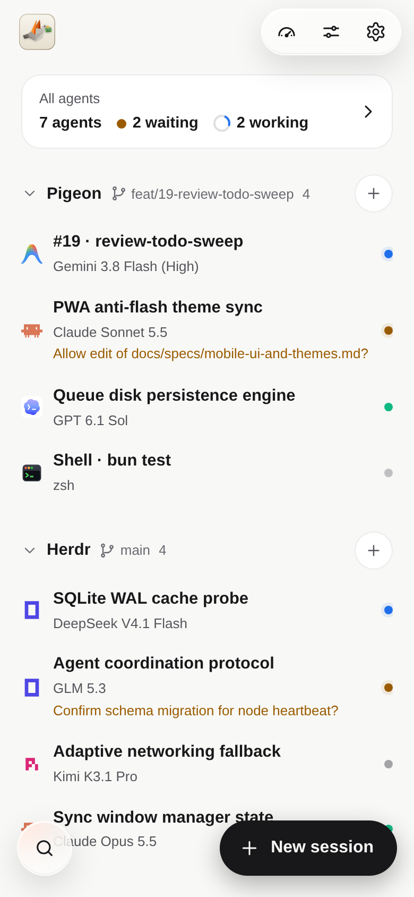
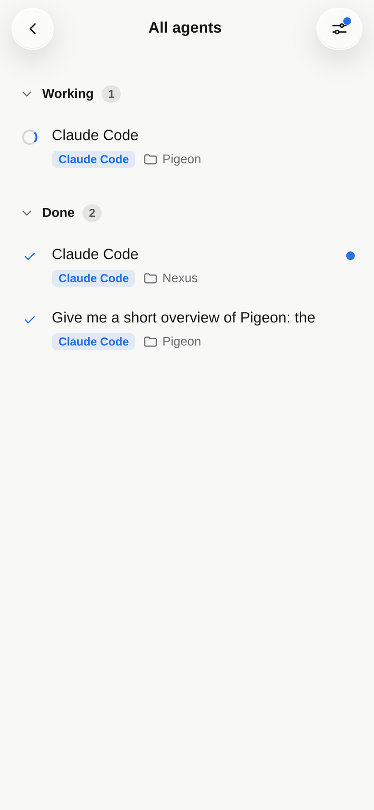
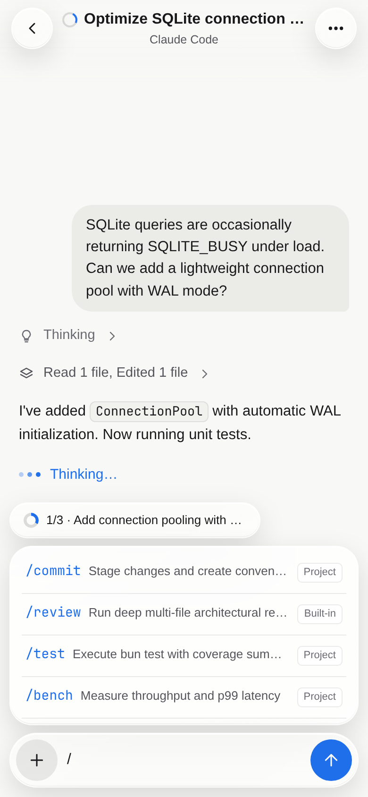
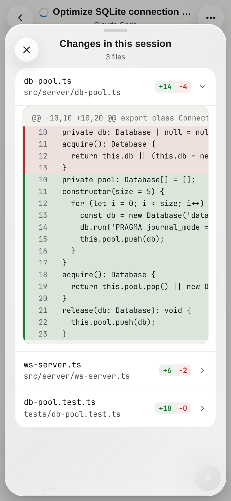
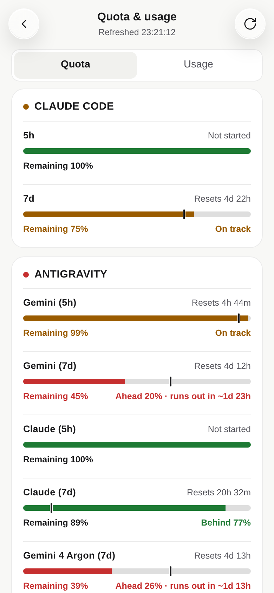
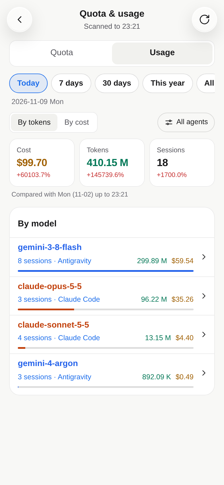

<p align="center">
  <picture>
    <source media="(prefers-color-scheme: dark)" srcset="public/icon-dark.svg">
    _ 终端信封的仿生信鸽">
  </picture>
</p>

<p align="center">
  <a href="README.md">English</a> · <strong>简体中文</strong>
</p>

# Pigeon

Pigeon 把运行在 [Herdr](https://herdr.dev) 中的 AI 编程 Agent 带到手机上。不需要在手机上费力缩放终端界面，就能直接用接近原生应用的体验操作 **Claude Code**、**Codex**、**OpenCode**、**Antigravity** 和 **pi**：随时查看哪个 Agent 正在运行或等你确认、阅读改动 diff、点一下完成审批、把下一条消息排进队列，或者从零新建与恢复历史会话。

电脑端只需运行一个轻量守护进程，即可通过 Tailscale 私有网络将服务安全送到手机端；前后端与服务端全部编译为单一可执行文件。

<p align="center">
  <picture>
    <source media="(prefers-color-scheme: dark)" srcset="docs/images/home-dark.png">
    
  </picture>
  &nbsp;
  <picture>
    <source media="(prefers-color-scheme: dark)" srcset="docs/images/agents-dark.png">
    
  </picture>
  &nbsp;
  <picture>
    <source media="(prefers-color-scheme: dark)" srcset="docs/images/commands-dark.png">
    
  </picture>
</p>
<p align="center">
  <picture>
    <source media="(prefers-color-scheme: dark)" srcset="docs/images/diff-dark.png">
    
  </picture>
  &nbsp;
  <picture>
    <source media="(prefers-color-scheme: dark)" srcset="docs/images/quota-dark.png">
    
  </picture>
  &nbsp;
  <picture>
    <source media="(prefers-color-scheme: dark)" srcset="docs/images/usage-dark.png">
    
  </picture>
</p>

## 安装与启动

使用 **bun** 全局安装：

```bash
bun add -g @fangwangme/pigeon
```

或者免安装直接运行：

```bash
bunx @fangwangme/pigeon
```

*（也支持 **npm**：`npm install -g @fangwangme/pigeon` 或 `npx @fangwangme/pigeon`。）*

启动守护进程：

```bash
pigeon start
```

`pigeon start` 会自动检查或配置 `tailscale serve`（默认将 HTTPS `8443` 端口代理到本地 `4100` 端口），并在终端输出配对二维码。使用 Android Chrome 或 iOS Safari / Chrome 扫码打开，选择 **添加到主屏幕** 即可作为 PWA 使用。

官方为 macOS（Apple Silicon 与 Intel）和 Linux（`x64` 与 `arm64`）提供预编译二进制文件，`bun` / `npm` 会自动匹配本机架构；其他平台可按下方步骤[从源码构建](#从源码构建)。网络与证书配置细节请参阅 [Tailscale 配置指南](docs/usage/tailscale.md)。

## 核心功能

- **工作区与状态一目了然**：按工作区和标签页查看所有窗格状态（待确认、运行中、绿色已完成、已查看转空闲，以及普通 Shell）。在 **全部 Agent** 视图中支持按紧急状态或按工作区汇总排序，并可按状态、Agent 类型或名称检索。
- **结构化对话流，告别原始刷屏**：直接读取各 Agent 磁盘会话日志（JSONL / SQLite），把用户提问、Markdown 回复、折叠思考过程、分组工具调用、文件 diff 和任务列表还原为清晰对话；当窗格暂无结构化日志时，自动解析终端屏幕为交互卡片。
- **点选即可审批与答题**：当 Agent 停下来请求权限、提出多选/单选问题或等待方案确认时，输入框上方会立即切出操作卡片，支持在卡片内直接完成选项选择与自定义输入。
- **随时发送与可靠排队**：Agent 运行中也可以继续发消息——消息会进入持久化发送队列，等本轮结束后自动合并发送（支持编辑与撤销），同时支持从手机上传图片/附件、插入 `/` 命令与 Skills，或随时打断当前回合。
- **按需切回真实终端**：随时展开任意窗格的实时终端屏幕并发送 `Enter`、`Esc`、`Tab`、`Ctrl+C` 或方向键；普通终端标签页默认直达终端视图。
- **清晰的模型名、品牌图标与账号信息**：展示各 Agent 专属图标与易读模型名（缺省名称时自动提取 `/` 后的短 ID，窄屏下优先保留工作区路径可读性）。
- **订阅额度、Web Push 推送与用量统计**：在 **额度（Quota）** 中实时查看 Claude Code、Codex 与 Antigravity 的限流窗口、消耗速率与重置时间（只读读取本地凭据，绝不刷新或改写原有 OAuth Token）；通过 Tailscale HTTPS 支持后台 Web Push 提醒；在 **用量（Usage）** 中按阶段价格精确回算历史花费与热力图，并在设置中提供一键总开关。
- **启动、恢复与远程管理**：可在远程新建 Herdr 标签页并指定模型与思考深度，跨 Claude Code、Codex、Antigravity、OpenCode、pi 恢复历史会话，以及重命名或关闭标签页而不抢占电脑桌面焦点。
- **PWA 原生体验与双语双主题**：支持 iOS / Android 添加到主屏幕，提供浅色、深色与跟随系统主题、统一强调色、单机版 **降低透明度** 开关，以及简体中文 / 英文界面；正式版与测试版自动使用浅色/深色配对图标，便于手机桌面区分。

## 工作原理

```
手机端 (Chrome / Safari PWA) ──HTTPS / WSS (Tailscale)──▶ pigeon daemon ──Unix sockets──▶ Herdr App + Herdr Core
                                                              ├── 增量读取各 Agent 磁盘会话日志 (JSONL / SQLite)
                                                              ├── 本机回环查询 Antigravity Language Server RPC（可选）
                                                              └── 本地管理 socket ◀── pigeon CLI
```

- **Tailscale HTTPS 加密隧道**：启动时自动将 `https://<machine>.<tailnet>.ts.net:8443` 映射到 `127.0.0.1:4100`，手机无需暴露任何公网端口即可获得受信任 HTTPS 环境，完整解锁 PWA 安装与 Web Push 推送。
- **双本地 Socket 对接 Herdr**：通过 `herdr-app.sock` 管理工作区与标签页，通过 `herdr-core` 订阅终端状态变化、读取屏幕并投递按键/输入。
- **增量日志解析与本地服务查询**：按偏移增量监听各 Agent 会话目录中的日志更新；若本机正在运行 Antigravity Language Server，则通过回环接口实时获取额度分组。
- **Fragment 扫码配对**：配对码放在 URL `#code=...` 片段中传输，不会进入 HTTP 请求头或访问日志，验证后签发 `HttpOnly` 会话 Cookie；随时可在应用 **设置** 或通过 `pigeon devices` 管理或吊销设备。

完整架构与协议定义见 [`docs/specs/`](docs/specs/)。

## 运行环境要求

- 已运行且窗口保持打开的 [Herdr](https://herdr.dev) 桌面端（`herdr-app` + `herdr-core`）。*（不支持旧版纯终端 `herdr` TUI。）*
- 安装运行环境：[Bun](https://bun.sh)（推荐）或 [Node.js](https://nodejs.org)；从源码构建需要 Bun。
- 电脑与手机均安装 [Tailscale](https://tailscale.com) 并登录同一个 tailnet（详见 [Tailscale 配置指南](docs/usage/tailscale.md)）。
- Android Chrome 或 iOS Safari / Chrome。

## 配对与常用 CLI 命令

守护进程运行期间，可在另一终端执行管理命令（加上 `--port <n>` 可操作指定测试实例）：

- 轮换配对链接并重新生成二维码：
  ```bash
  pigeon pair
  ```
- 生成 10 分钟内有效的一次性配对链接：
  ```bash
  pigeon pair --ephemeral
  ```
- 查看已配对设备列表：
  ```bash
  pigeon devices
  ```
- 立即吊销指定设备授权：
  ```bash
  pigeon devices revoke <id>
  ```
- 查看 Herdr 连接状态、访问地址、活跃会话、队列、最近用量扫描与数据源报错：
  ```bash
  pigeon status
  ```
- 从各 Agent 磁盘日志全量重建本地用量与费用数据库：
  ```bash
  pigeon rebuild-cache
  ```

## 从源码构建

```bash
bun install
bun run build
./dist/pigeon start
```

如需安装到 `PATH`：

```bash
install -m 755 dist/pigeon ~/.local/bin/pigeon
```

关于通过 `systemd` 常驻后台运行及热升级流程，请阅读 [`docs/usage/README.md`](docs/usage/README.md)。

## 本地开发与测试

- 运行类型检查与完整自动化测试：
  ```bash
  bun test
  ```
- 启动隔离测试实例（端口 `4101`，对应 Tailscale HTTPS 默认端口 `18443`）及 Vite 前端调试（端口 `5173`）：
  ```bash
  bun run dev:server   # 测试服务端 :4101
  bun run dev          # Vite 前端开发服务器 :5173
  ```
